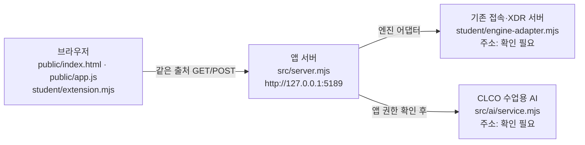

# 학생 설명서 (TimoAleph 시험0 참고 구현 초안)

> 이 문서는 오너 시험0 계정용 **참고 구현 후보의 초안**입니다. 일반 학생의 성취물이나 제공 시작 틀의 기본 문서가 아닙니다.
> 이 초안을 쓸 때 아래 명령·화면·연결은 **하나도 실행하지 않았습니다**. 실행해 확인한 항목만 나중에 "확인됨"으로 바꿉니다.

## 1. 목적과 기능

보안 Agent 학생 앱은 지금 로그인한 사용자·기기·세션, 업무 앱 접속 판정, 내 접속 기록과 XDR 경보, 알림과 도움정보, 수업용 AI 연결 점검과 근거 기반 사건 설명, 조치 처리 상태, 설치 패키지의 OSV 대조를 보여 줍니다. 학생이 만든 부분은 그 결과를 **받은 그대로 정확하게 표시**하는 화면입니다. 판정·집행·조회 자체는 서버와 원천이 합니다.

## 2. 지원 환경과 버전

| 항목 | 값 | 상태 |
|---|---|---|
| Node.js | 시작 틀 `package.json`의 `engines.node` 값(제공 시작 틀 기준 `24.19.0`) | 확인 필요(조립한 새 프로젝트의 `package.json`으로 대조) |
| 운영체제 | Windows (제공 실행 도구가 PowerShell 기준) | 확인 필요 |
| 브라우저 | 1280px 이상 데스크톱 브라우저 | 확인 필요 |
| 이 학생 구현 버전 | 검증 중 버전(v1.0 아님) | 22단계 기록 참고 |

## 3. 설치·실행

아래 명령은 제공 안내서(`docs/STUDENT_LAUNCH_GUIDE.md`)에 있는 명령을 옮긴 것입니다. 이 초안 작성 중에는 실행하지 않았으므로 모두 **확인 필요**입니다.

| 순서 | 명령(새 PowerShell 창, 앱 폴더) | 상태 |
|---|---|---|
| 1 | `node --version` | 확인 필요 |
| 2 | 제공 안내서의 실행 도구 또는 `npm start` | 확인 필요 |
| 3 | 브라우저에서 `http://127.0.0.1:5189/` 열기 | 확인 필요 |
| 4 | `npm run check`(학생 파일 문법만 확인) | 확인 필요 |

`npm run demo`는 예제 자료만 보여 줍니다. 실제 연결이나 성취로 적지 않습니다.

## 4. 구성도

- 학생 코드(`student/extension.mjs`)는 요청을 보내지 않습니다. 제공 화면이 받은 자료를 표시 함수에 넘겨 주고, 학생 함수는 DOM 요소를 돌려줍니다.
- AI 점검·설명·조치 요청은 제공 화면의 버튼만 보냅니다.
- 상자의 실제 주소(기존 접속·XDR 서버, 수업용 AI)는 실행해 확인하지 않았으므로 확인 필요로 둡니다.

## 5. 제공 부분과 학생 구현 부분

제공 부분은 시작 틀 manifest(`.on-starter-manifest.json`)에 적힌 파일입니다(`public/`, `src/`, `tools/`, 제공 문서 등). 이 참고 구현은 제공 실행 코드를 바꾸지 않습니다. 학생이 바꾼 파일은 `student/extension.mjs`, `README.md`, 이 문서와 22단계 기록 문서입니다.

| 학생 함수 | 보여 주는 것 |
|---|---|
| `renderIdentity` (13) | 사용자·기기·세션과 상태(원래 값 함께). 실패하면 "연결 실패"와 메시지만 남기고 이전 사용자 이름을 지움. 예제 자료·연결 없음 표시 |
| `renderDecision` (14) | 허용(allow)·거부(deny)·추가 확인 필요(challenge)·확인 불가(unknown)와 이유·확인 시각. 요청 실패는 거부 판정이 아니라고 따로 표시 |
| `renderEvents` (15·16) | 최신순 기록, 「기록 종류」·「업무 앱」·「접속 상태」 걸러 보기, 「<ID> 상세」의 근거·규칙·세 상태. 원천이 지원하지 않는 조치는 「<조치> 미지원」 비활성 안내만 둠 |
| `renderStatus` (16) | 기기·세션의 불러오는 중·없음·실패, 시간 초과, 알림, 도움정보와 「도움정보 복사」 버튼(누를 때만 안전한 값 복사) |
| `renderAiConnection` (17) | 시험 연결(test)·앱 권한 확인 후(verified) 점검, 모델 수, 점검 시각. 연결만 점검했고 사건 설명은 아직이라고 표시. 오류는 코드와 원인별 안내 |
| `renderExplanation` (17·18) | 고른 기록의 AI 설명(참고용), 인용 근거, 규칙, 확인 불가 상태, 제안과 사람 확인 필요·미실행. 근거가 맞지 않거나 이미 실행했다는 답은 쓸 수 없다고 표시 |
| `renderAction` (19) | 미실행·준비됨·서버 전달 중·접수(ACK)·효과 확인·거절·실패·결과 불명·기한 지남을 구분. 효과 확인은 원천 관측(effectApplied: true)일 때만 |
| `renderVulnerabilities` (20) | 전체 조회 상태, lock 파일 버전·해시, 패키지별 설치된 정확한 버전·OSV 결과·출처·조회 시각. 조회 실패·미조회를 취약점이 없다는 뜻으로 쓰지 않음 |

## 6. 실패별 안내

| 화면 문구(학생 칸) | 원인 | 확인할 것 |
|---|---|---|
| 연결 실패: … / 신원을 확인할 수 없습니다 | 앱 서버나 엔진 응답 없음 | 앱 서버가 켜졌는지, 위쪽 다시 불러오기를 직접 누름 |
| 요청 실패: … 거부 판정이 아닙니다 | 접속 판정 요청이 처리되지 않음 | 서버 상태 확인 뒤 다시 요청 |
| 확인 불가(unknown) | 서버가 판정을 내리지 못함 | 접속할 수 있다고 보지 않고 담당자 확인 |
| 기록 불러오기 실패: … | 기록 요청 실패 | 다시 불러오기를 직접 누름. 빈 목록과 다름 |
| 기기 불러오기 실패 … 시간 초과 | 응답 지연 | 잠시 뒤 다시 불러오기를 직접 누름(자동 재시도 없음) |
| AI 연결 점검 결과를 받지 못했습니다: ON_AI_PROVISIONING_PENDING 등 | 앱 권한 준비 중·인증·접근 제한·사용량·한도·이용 시간·제한·시간 초과·취소·모델 없음 | 화면에 나온 원인별 안내를 따름. 운영 준비가 필요한 항목은 학생 잘못이 아님 |
| AI 설명 실패 / 근거가 맞지 않아 이 설명은 쓸 수 없습니다 | AI 응답이 근거·형식 검사를 통과하지 못함 | 기록은 그대로임. 필요하면 설명을 다시 요청 |
| 결과 불명(unknown) | 조치 결과를 확인할 수 없음 | 효과 유무를 판단하지 않고 제공 화면에서 원천 결과만 재조회 |
| 조회 실패 / 조회를 취소했습니다 | 패키지 조회 실패·취소 | 직접 다시 조회. 이전 결과를 현재 결과로 보지 않음 |
| 조회 준비 미완료(not_configured) / 아직 조회 안 함(not_checked) | 프로젝트 설정 없음·승인된 공개 패키지 없음 | 담당자 설정 확인. 취약점이 없다는 뜻이 아님 |

## 7. 지원 범위

**원문으로 구현한 것(실행 검증 아님)**: 위 5절의 여덟 표시 함수.

**합성 확인만 한 것**: 이 초안 단계에서는 정적 계약 검토(소스 문자열 검사)만 준비했고 실행하지 않았습니다.

**기다림(UNV) — 실제로 확인하지 못한 것**
- 실제 앱 서버·엔진 연결과 화면 표시(실행하지 않음)
- 실제 수업용 AI 연결 점검과 사건 설명(앱 권한·운영 준비 필요)
- 실제 원천 조치 집행과 결과 재조회(지금 기록의 supportedActions가 비어 있음)
- 실제 OSV 조회(허용 목록이 비어 있으면 not_configured·not_checked가 정상)
- 새 빈 폴더 설치·실행 재현(22단계 기록 문서에서 따로 다룸)

열쇠·토큰·비밀 값은 이 문서와 코드에 넣지 않습니다.
